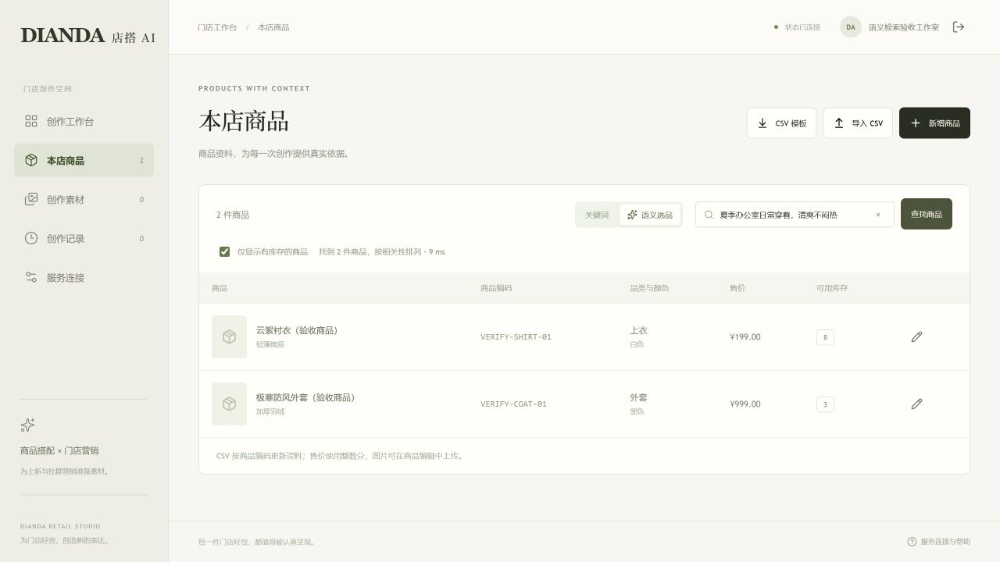
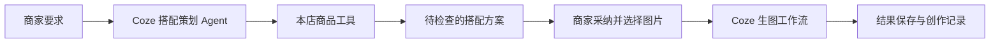

# 店搭 AI · 线下零售门店创作平台

面向线下服饰零售门店，围绕在售商品与实际库存，提供语义选品、搭配策划和营销图片创作，支持门店上新、导购推荐及社群营销素材准备。使用 Vue 3、Node.js、Coze 和 Qdrant，商品语义检索已完成本机联调，Coze 生图工作流与 Agent 当前保留草稿。

GitHub 仓库：<https://github.com/kami-ay1/retail-store-ai-studio>。



## 运行项目

需要 Node.js 24.12 或更高版本、pnpm 11。

```powershell
pnpm install
./Start-Qdrant.ps1
pnpm dev
```

当前电脑也可以在 PowerShell 中运行 `./Start-Project.ps1`。该脚本先启动本机 Qdrant，再使用 Codex 已提供的 Node.js 24 启动业务服务与页面。可以通过 `-NodeExecutable` 参数指定其他 Node.js 24 可执行文件。

前端地址为 `http://127.0.0.1:5173`，业务接口为 `http://127.0.0.1:4317`。服务仅监听本机地址。

创建自己的商家账户后，导入商品 CSV、上传模特图和商品图，在创作工作台提交搭配图生成任务。

## 商品语义检索

在“本店商品”切换到“语义选品”，输入用途、风格或面料要求，例如“夏季办公室日常穿着，清爽不闷热”。结果按语义相关性排序，可选择只显示有库存的商品。关键词查询继续用于名称、编码和品类的直接筛选。

- Qdrant 1.20.0 监听本机 `127.0.0.1:6333`，Windows 启动脚本从官方发布页下载并校验安装包，数据保存在 `.data/qdrant/`。
- 中文向量模型固定为 `Xenova/bge-small-zh-v1.5`，版本 `7a21cfa835a0d8cba006e36210e7843b232a1107`，使用本机 CPU、量化 ONNX、CLS 池化和归一化，输出 512 维向量。首次使用下载模型至 `.data/models/`，之后复用缓存。
- 商品文本在本机生成向量。Qdrant 默认也运行在本机，未使用外部 Embedding 推理服务。
- 商品新增、编辑和 CSV 导入时，在业务事务内记录待同步任务；后台批量写入向量与商家、品类、库存和商品版本等筛选字段。
- 查询使用服务器会话中的商家身份强制过滤，返回前再次核对 SQLite 中的版本、库存和品类。索引同步中返回明确的等待状态，同步失败可以在商品页面重试。
- Agent 的 `search_products` 对非空自然语言要求使用同一向量检索服务；空查询明确表示浏览本店商品。Coze 云端资源仍按当前配置保持草稿。

连接已有 Qdrant 时，可在服务端配置以下字段，再重新启动 Node.js 服务：

```dotenv
QDRANT_URL=http://127.0.0.1:6333
QDRANT_API_KEY=
QDRANT_COLLECTION=moyou_products_bge_small_zh_v1_5
```

索引集合必须使用相同模型和 512 维 Cosine 距离。连接新集合时，业务库中的现有商品会重新排入同步任务。“服务连接”页面显示服务状态、当前商家的索引数量和真实错误信息。详细设计和接口见 [商品检索说明](docs/product-search.md)。

## 配置 Coze

当前生图工作流与搭配 Agent 按要求保持草稿，模型 API 调用关闭。草稿状态下可以使用本地账户、商品和素材管理功能。“魔柚商品工具”端插件已发布 v0.0.1。

项目中的 `.env` 保存当前电脑的私有配置，`.env.example` 只提供字段说明。Coze Token 不会发送给前端。

```dotenv
PORT=4317
WEB_ORIGIN=http://127.0.0.1:5173
DATA_DIR=.data
COZE_API_TOKEN=填写本项目的Coze访问令牌
COZE_WORKFLOW_ID=填写已发布的生图工作流ID
COZE_BOT_ID=填写已发布的搭配策划AgentID
COZE_WORKFLOW_PUBLISHED=false
COZE_AGENT_PUBLISHED=false
```

修改 `.env` 后重新启动 Node.js 服务。在“服务连接”页面查看配置状态。

两个 PUBLISHED 字段记录对应资源的发布状态。当前均为 `false`；只有在资源实际发布并完成访问令牌配置后，才将对应字段改为 `true`。

生图工作流的节点、输入输出和当前工作空间地址见 [Coze 生图工作流](docs/coze-workflow.md)。Agent 的提示词见 [Agent 工作要求](docs/coze-agent-prompt.md)，三个端插件工具定义见 [JSON 配置](docs/coze-plugin.json) 和 [OpenAPI 配置](docs/coze-plugin.yaml)。

Coze Token 需要对当前工作空间开放工作流执行、文件上传以及智能体对话和工具结果提交所需权限。只使用服务端配置，不将访问令牌填写到前端源码或浏览器地址中。

## 导入商品

在“本店商品”页面下载 CSV 模板，使用 UTF-8 编码。列名如下：

```csv
sku,name,category,color,material,priceCents,stock,description
```

- `sku`：当前店铺内唯一的商品编码。
- `name`、`category`：商品名称和品类，必填。
- `color`、`material`、`description`：没有资料时可以保留空字符串。
- `priceCents`：整数分，例如 19900 表示 199.00 元。
- `stock`：非负整数。

一次最多导入 2000 条。系统先校验整份文件，再在同一数据库事务中写入。匹配到同一店铺的既有商品编码时更新资料和版本，保留已经上传的商品图片。

## Agent 的实际职责

搭配策划 Agent 通过 Coze 端插件调用本地业务服务：

1. `search_products` 根据自然语言要求，通过 Qdrant 检索当前店铺商品；空要求浏览本店商品。
2. `get_product` 读取候选商品的真实资料与最新版本。
3. `propose_outfit` 保存可检查的搭配方案。

工具调用、参数、返回数据和方案会保存到数据库并显示在工作台。生成图片需要商家明确采纳方案并提交任务，Agent 不直接执行图片生成。

所有工具的商家范围由服务器会话确定，模型无法通过参数改变商家身份。方案和图片任务引用商品版本，过期版本、无库存商品或不属于本店的素材会被拒绝。



## 任务与数据保存

- SQLite 保存账户、商家、商品、素材资料、搭配方案、生成任务与事件。
- 图片文件保存到 `.data/uploads`，由经过登录验证的接口读取。
- 图片任务有排队、运行、成功、失败及中断状态，不显示估算百分比。
- 请求使用幂等标识，重复提交同一请求不会创建额外任务。
- SSE 事件保存到数据库，浏览器重连后可以按事件游标读取状态。
- 服务重启后，正在执行但结果未确认的任务会标记为中断，避免自动再次调用可能已经消耗额度的生成请求。
- 生成结果只从指定的 Coze 图片 CDN 下载到本地保存。不同图片服务的结果域名需要按实际服务配置核实。

## 验证

```powershell
pnpm typecheck
pnpm test
pnpm test:integration
```

测试使用独立的真实 SQLite 数据库和本地 HTTP 服务，验证 CSV 解析与原子导入、商品版本冲突、账户并发注册、商家隔离以及 Agent 工具权限。测试不会伪造 Coze 生图或 Agent 响应。

集成测试需要本机 Qdrant 运行，使用真实中文模型、独立 SQLite 数据库和单独的验收集合，验证语义检索、商家隔离、库存与品类过滤、版本一致性、索引同步及 HTTP 接口。验收记录保存在忽略的 `work/` 和 `.data/` 中，不作为生产商家资料。

完整的模型联调需要当前工作空间的真实 Coze 配置、可用额度与上传授权。具体已完成的验证范围见 [验证记录](docs/verification.md)。

## 简历项目归类

项目归属、工作职责和上线时间按实际工作情况描述；本地能力与验证范围以验证记录为依据。面试可重点讲解：Qdrant 语义检索、商品自动索引同步、Agent 业务工具、商家数据隔离、商品版本校验、图片任务幂等、SSE 状态同步，以及商品资料与生图提示词的关联。

## 项目目录

- `client/src`：Vue 3 页面、Pinia 状态与业务组件。
- `shared/contracts.ts`：前后端共享的 Zod 协议与类型。
- `server`：Node.js、Express、SQLite、素材管理和 Coze 接入。
- `tests/server`：与服务端源码对应的测试。
- `tests/integration`：真实 Qdrant、向量模型及 HTTP 联调验收。
- `docs`：Coze 工作流、端插件和 Agent 配置。
- `.data`：私有运行数据，已经加入忽略规则。
