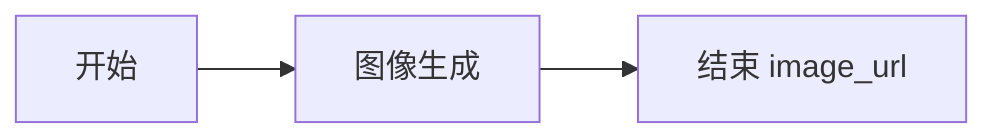

# Coze 商家搭配图工作流

工作流名称：`moyou_outfit_image`。

发布状态：草稿，按当前要求暂缓发布。

当前工作空间中创建的工作流：[打开编辑器](https://www.coze.cn/work_flow?workflow_id=7701694522154532927&space_id=7701684097798045711)。

## 开始节点

| 参数 | 类型 | 必填 | 用途 |
| --- | --- | --- | --- |
| model_image | Image | 是 | 模特图片 |
| product_image | Image | 是 | 商品图片 |
| prompt | String | 是 | 由实际商品资料、场景和商家要求构成的完整提示词 |

Node.js 服务先调用 Coze 官方文件上传 API，再以 `{"file_id":"..."}` 的 JSON 字符串形式传入两个 Image 参数。

## 图像生成节点

- 模型：当前配置为 Seedream 5.0 Lite。
- 比例：3:4，1728 × 2304。
- 图片数量：1。
- 参考图 1：`开始.model_image`。
- 参考图 2：`开始.product_image`。
- 输入变量 `prompt`：绑定 `开始.prompt`。
- 提示词：`{{prompt}}`。
- 异常处理：中断流程，不进行隐式重试。

## 结束节点

输出模式：返回变量。

| 输出参数 | 来源 |
| --- | --- |
| image_url | 图像生成.data |

业务服务要求最终结果包含有效的 `image_url`，解析失败会保存为明确的失败任务。

## 模型验证

使用有权使用的模特图和商品图，检查人物、衣服颜色、纹理、领口、袖长及画面比例。只在实际运行完成后记录生成结果，不用手工图片替代工作流输出。

参考文档：[图像生成节点](https://docs.coze.cn/guides_image_generation_node)、[流式运行工作流](https://docs.coze.cn/developer_guides_workflow_stream_run)、[通过 API 使用端插件](https://docs.coze.cn/guides_use_local_plugin)。
