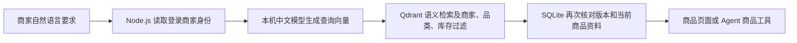

# 商品语义检索

## 数据处理

SQLite 保存商品业务资料。商品写入触发器在同一事务中更新 `productSearchIndex`，后台按每批最多 16 件领取任务，使用本机中文模型生成向量并写入 Qdrant。Qdrant 写入确认后，仅在商品版本仍一致时将任务标记为已同步。

新请求与更新后的商品资料不会混用旧向量：索引等待同步时搜索接口返回 409；索引失败时返回明确错误，用户可重试。进程重启后恢复未完成的索引任务；新建集合时重新同步已有商品。

## 查询

向量输入包含商品名称、品类、颜色、材质和描述。售价、库存和商品版本以 SQLite 的最新数据为准。每次查询使用服务端会话中的 `merchantId`，客户端和 Agent 不得指定其他商家身份。

返回结果包含原始相似度分数。分数不表示概率，也不作为“匹配准确率”展示。库存和品类属于明确业务条件，使用筛选字段约束；语义相似度只用于候选排序。

## 接口

| 方法与路径 | 用途 |
| --- | --- |
| `POST /api/products/search` | 语义检索，接受 query、category、inStock、limit |
| `GET /api/products/search-index` | 查看当前商家索引数量、任务状态和服务错误 |
| `POST /api/products/search-index/retry` | 用户明确重试连接与本店失败的索引任务 |

三个接口均需要商家登录。搜索最多返回 12 件候选商品。非空自然语言要求由 Agent 的 `search_products` 调用同一服务，空要求明确执行商品列表查询。

## 本机启动

运行 `Start-Project.ps1` 会启动 Qdrant、Node.js 和 Vue 开发页面。Qdrant 仅监听本机，模型和数据库位于项目忽略的 `.data/`。Windows 启动脚本对存储目录使用进程级扩展路径，支持位于深层目录的真实索引文件，不修改系统设置。

可通过服务端的 `QDRANT_URL`、`QDRANT_API_KEY` 与 `QDRANT_COLLECTION` 连接已有服务。配置已有集合时应保持当前固定模型、版本、维度和距离类型一致。Coze 资源的发布及 GPT 生图接口配置独立管理。

## 验证

运行 `pnpm test:integration` 使用真实 Qdrant 和中文模型，测试数据写入独立 SQLite 数据库与验收集合。覆盖自然语言检索、中文单字符、品类与库存筛选、商家隔离、商品编辑与 CSV 同步、过期版本排除、Agent 工具调用、HTTP 鉴权、服务重启、新集合重建及连接失败。

浏览器中使用独立的“语义检索验收工作室”新增标明验收用途的商品，再执行自然语言查询。测试账户和商品用于验证功能，不作为真实商家经营记录。图片生图和 Coze 云端 Agent 仍按既有配置保持草稿，未计入此次联调成功范围。

## 官方资料

- [Qdrant Windows 1.20.0 官方发布](https://github.com/qdrant/qdrant/releases/tag/v1.20.0)
- [Qdrant JavaScript SDK](https://github.com/qdrant/qdrant-js/tree/master/packages/js-client-rest)
- [商家范围过滤](https://qdrant.tech/documentation/manage-data/multitenancy/)
- [中文 BGE 模型](https://huggingface.co/BAAI/bge-small-zh-v1.5)
- [Transformers.js 兼容模型](https://huggingface.co/Xenova/bge-small-zh-v1.5)
